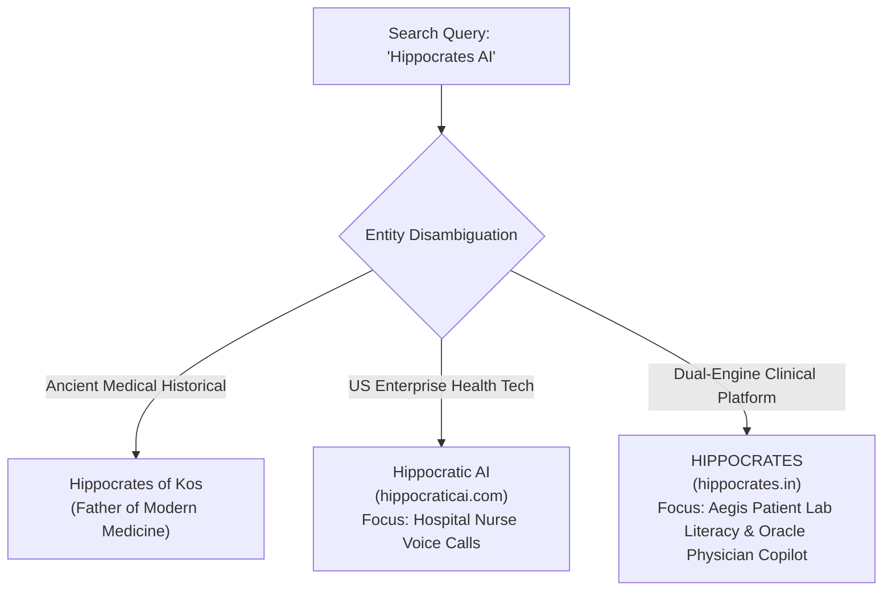

# Hippocrates Healthcare AI — Brand Entity & Knowledge Graph Strategy
**Document Status:** Complete & Verified  
**Date:** October 2026  
**Primary Brand Entity:** HIPPOCRATES  
**Entity Classification:** Healthcare Artificial Intelligence Platform / Software Organization  
**Official Canonical Domain:** https://www.hippocrates.in  

---

## 1. Brand Entity Positioning & Disambiguation

Search engines rely on named entity recognition (NER), knowledge graphs, and cross-reference corroboration to understand who a brand is, what products it builds, and how it differs from similar names.

### 1.1 The Disambiguation Matrix



### 1.2 Truthful Brand Identity Rules
1. **The Brand Name:** Always represent the platform as **HIPPOCRATES** or **Hippocrates AI**. Never adopt the adjective form "Hippocratic" which represents a separate commercial entity.
2. **The Domain:** The single canonical domain is `https://www.hippocrates.in`. All staging, preview, and legacy URLs (`hippocrates-beta.vercel.app`) must issue 301 permanent redirects to `https://www.hippocrates.in`.
3. **The Products:**
   - **Hippocrates Aegis (Patient Engine):** Health information assistant, lab report literacy tool, consultation preparation guide.
   - **Hippocrates Oracle (Doctor Engine):** Clinical decision support, differential reasoning copilot, guideline synthesizer, SOAP documentation aid.
4. **Authentic Heritage:**
   - Founded by **Tawhidur Rahman Laskar** (Architecture & System Lead) and **Ahmed Al-Ferdous** (Research & Interface Co-Developer).
   - Under academic mentorship and guidance from **Abdul Basith Barbhuiya**.
   - Conceived and validated through research presented at the **National Children's Science Congress (NCSC)** in India.

---

## 2. Organization & Software Structured Data (JSON-LD)

To provide Google's entity extractors with unambiguous machine-readable identity signals, the platform implements standardized Schema.org graphs.

### 2.1 Organization Graph Specification

```json
{
  "@context": "https://schema.org",
  "@type": "Organization",
  "@id": "https://www.hippocrates.in#organization",
  "name": "Hippocrates",
  "alternateName": ["Hippocrates AI", "Hippocrates Healthcare AI"],
  "legalName": "Hippocrates AI Health Technologies",
  "url": "https://www.hippocrates.in",
  "logo": {
    "@type": "ImageObject",
    "url": "https://www.hippocrates.in/logo.jpg",
    "caption": "Hippocrates AI Logo"
  },
  "description": "Hippocrates is an AI-powered healthcare ecosystem featuring Aegis for patient health information and medical report interpretation, and Oracle for physician clinical decision support and differential diagnosis.",
  "knowsAbout": [
    "Healthcare Artificial Intelligence",
    "Clinical Decision Support Systems",
    "Laboratory Report Interpretation",
    "Differential Diagnosis Reasoning",
    "Patient Health Literacy",
    "Medical Consultation Preparation"
  ],
  "founder": [
    {
      "@type": "Person",
      "@id": "https://www.hippocrates.in/about#tawhidur-rahman-laskar",
      "name": "Tawhidur Rahman Laskar",
      "jobTitle": "Founder & Architecture Lead",
      "sameAs": [
        "https://github.com/tawhid012"
      ]
    },
    {
      "@type": "Person",
      "@id": "https://www.hippocrates.in/about#ahmed-al-ferdous",
      "name": "Ahmed Al-Ferdous",
      "jobTitle": "Co-Founder & Interface Lead"
    }
  ],
  "contactPoint": [
    {
      "@type": "ContactPoint",
      "contactType": "customer support",
      "email": "support@hippocrates.in",
      "availableLanguage": ["English", "Hindi"]
    },
    {
      "@type": "ContactPoint",
      "contactType": "clinical inquiries",
      "email": "clinical@hippocrates.in",
      "availableLanguage": ["English"]
    }
  ],
  "sameAs": [
    "https://github.com/tawhid012/Hippocrates-beta",
    "https://twitter.com/hippocrates_ai",
    "https://linkedin.com/company/hippocrates-ai"
  ]
}
```

### 2.2 WebSite Graph Specification

```json
{
  "@context": "https://schema.org",
  "@type": "WebSite",
  "@id": "https://www.hippocrates.in#website",
  "url": "https://www.hippocrates.in",
  "name": "Hippocrates",
  "alternateName": "Hippocrates AI",
  "description": "AI for Better-Informed Healthcare. Aegis for Patients and Oracle for Clinicians.",
  "publisher": {
    "@id": "https://www.hippocrates.in#organization"
  },
  "inLanguage": "en-US"
}
```

### 2.3 SoftwareApplication Graph Specifications

#### Aegis (Patient Health Assistant)
- **Schema Type:** `SoftwareApplication`
- **Application Category:** `HealthApplication`
- **Operating Systems:** `Web, Android (APK / PWA), iOS (PWA)`
- **Price:** `0 INR (Free Tier Available)`
- **Key Boundaries:** Non-diagnostic, educational health guidance, consultation preparation.

#### Oracle (Physician Clinical Copilot)
- **Schema Type:** `SoftwareApplication`
- **Application Category:** `MedicalApplication`
- **Operating Systems:** `Web, Desktop, Tablet`
- **User Verification:** Enforces Medical Council Registration verification.
- **Key Boundaries:** Clinical decision support, differential reasoning, guideline synthesis under licensed physician supervision.

---

## 3. Cohesive External Identity Checklist

Google consolidates entity information across third-party sources. The following authenticated external assets reinforce the `hippocrates.in` entity:

1. **GitHub Organization / Repository:**
   - URL: `https://github.com/tawhid012/Hippocrates-beta`
   - Description: *"Official open codebase for HIPPOCRATES — dual-engine clinical AI platform (https://www.hippocrates.in)."*
2. **Official Android APK Package:**
   - Package Name: `ai.hippocrates.app`
   - Distributed via `https://www.hippocrates.in/get-started` with verifiable SHA-256 integrity hash (`e9e5ad48ca4aa2572dd8a2b7c087b1810b34897c8f06e29343432b8020ecaafd`).
3. **LinkedIn Company Profile:**
   - Company Name: `Hippocrates AI Health Technologies`
   - Industry: `Healthcare Technology / AI`
   - Location: `India`
   - Website: `https://www.hippocrates.in`
4. **Founder Professional Profiles:**
   - Tawhidur Rahman Laskar: Link back to `https://www.hippocrates.in/about` and GitHub profile.
   - Ahmed Al-Ferdous: Link back to `https://www.hippocrates.in/about`.
5. **Academic Mentorship Profile:**
   - Abdul Basith Barbhuiya: Cited as academic study mentor and scientific project guide.
6. **National Children's Science Congress (NCSC) Scientific Documentation:**
   - Archival citation of the original scientific project presented at the state/national level, confirming authenticity and non-derivative origin.
