# Hippocrates Healthcare AI — Information Architecture & Keyword Mapping
**Document Status:** Complete & Verified  
**Date:** October 2026  
**Primary Domain:** https://www.hippocrates.in  

---

## 1. Architecture Philosophy & Structural Blueprint

Hippocrates rejects thin, programmatic SEO doorway pages. Instead, the public website follows an **Authority Hub-and-Spoke Topology** centered around genuine product capabilities and evidence-based clinical education.

```mermaid
graph TD
    Home["Homepage (/)<br/>Entity Authority & Dual-Engine Overview"]
    
    Home --> Platform["/platform<br/>Dual-Engine Architecture"]
    Home --> Aegis["/aegis<br/>Patient Health Assistant"]
    Home --> Oracle["/oracle<br/>Doctor Clinical Copilot"]
    Home --> Reports["/medical-reports<br/>Lab Report Interpretation Hub"]
    Home --> Knowledge["/knowledge<br/>Clinical Knowledge Hub"]
    Home --> Safety["/safety<br/>Responsible AI & Clinical Safety"]
    Home --> About["/about<br/>Team, Mission & NCSC Study"]
    Home --> Download["/get-started<br/>Android APK & PWA Access"]
    
    Aegis --> ForPatients["/for-patients<br/>Patient Workflows"]
    Oracle --> ForDoctors["/for-doctors<br/>Physician Workflows"]
    
    Reports --> KB1["/knowledge/understanding-cbc-blood-test"]
    Reports --> KB2["/knowledge/understanding-thyroid-panels"]
    Reports --> KB3["/knowledge/understanding-liver-function-tests"]
    Reports --> KB4["/knowledge/understanding-kidney-function-tests"]
    
    Aegis --> KB5["/knowledge/how-to-prepare-for-doctor-visit"]
    Oracle --> KB6["/knowledge/ai-clinical-decision-support-explained"]
    Safety --> KB7["/knowledge/responsible-ai-in-healthcare"]
```

---

## 2. Definitive Route & Keyword-to-Page Mapping

| Path | Primary Search Intent | Target Primary Topic | Secondary Topics | Title Tag & Metadata Anchor | Schema Implemented | Medical Review Level | Canonical URL |
| :--- | :--- | :--- | :--- | :--- | :--- | :--- | :--- |
| `/` | Branded Navigational | Hippocrates Healthcare AI | Hippocrates official site, Aegis, Oracle | `Hippocrates — AI for Better-Informed Healthcare \| Official Website` | `Organization`, `WebSite`, `SoftwareApplication` | Not required (Corporate/Entity) | `https://www.hippocrates.in` |
| `/platform` | Commercial / Tech Architecture | Dual-Engine Healthcare AI | Healthcare AI infrastructure, clinical AI models | `Platform Architecture — Dual-Engine Clinical Intelligence` | `SoftwareApplication` (Aegis + Oracle) | System Architect Verified | `https://www.hippocrates.in/platform` |
| `/aegis` | Product / Patient Guidance | Aegis Patient Health Assistant | Symptom exploration, consultation prep | `Aegis — Patient-Focused Health Information & Guidance` | `SoftwareApplication`, `FAQPage`, `BreadcrumbList` | Clinical Review Board | `https://www.hippocrates.in/aegis` |
| `/oracle` | Product / Clinical Copilot | Oracle Physician Copilot | Differential diagnosis, clinical decision support | `Oracle — Doctor-Focused Clinical Support & Decision Reasoning` | `SoftwareApplication`, `FAQPage`, `BreadcrumbList` | Clinical Review Board | `https://www.hippocrates.in/oracle` |
| `/for-patients` | Persona Guide / Informational | Patient Healthcare AI Tools | Understanding health, lab reports for patients | `For Patients — How Hippocrates Aegis Simplifies Healthcare` | `SoftwareApplication`, `FAQPage`, `BreadcrumbList` | Clinical Review Board | `https://www.hippocrates.in/for-patients` |
| `/for-doctors` | Persona Guide / Informational | AI Clinical Tools for Doctors | Differential reasoning, SOAP documentation | `For Doctors — Oracle AI Clinical Copilot & Decision Support` | `SoftwareApplication`, `FAQPage`, `BreadcrumbList` | Clinical Review Board | `https://www.hippocrates.in/for-doctors` |
| `/medical-reports` | Informational / Educational | AI Medical Report Explanation | Understanding blood tests, lab reference ranges | `Understanding Medical Reports & Blood Tests — Educational Guide` | `MedicalWebPage`, `FAQPage`, `BreadcrumbList` | Clinical Review Board | `https://www.hippocrates.in/medical-reports` |
| `/safety` | Trust / Regulatory & Ethics | Responsible AI in Healthcare | Clinical safety rails, non-autonomous boundaries | `Responsible Healthcare AI & Safety Principles — Hippocrates` | `MedicalWebPage`, `BreadcrumbList` | Academic Guide Verified | `https://www.hippocrates.in/safety` |
| `/about` | Brand Entity / Founder Story | About Hippocrates AI | Founders, NCSC study, academic mentorship | `About Hippocrates AI — Mission, Team & Project History` | `Organization`, `Person`, `BreadcrumbList` | Founder Verified | `https://www.hippocrates.in/about` |
| `/get-started` | Transactional / App Download | Download Hippocrates APK | Android healthcare app, PWA installation | `Download Hippocrates for Android (Official APK) — Hippocrates AI` | `SoftwareApplication`, `BreadcrumbList` | System Lead Verified | `https://www.hippocrates.in/get-started` |
| `/knowledge` | Hub / Resource Exploration | Medically Reviewed Clinical Guides | Patient education, doctor workflows, AI safety | `Knowledge Hub — Medically Reviewed Clinical & Health Guides` | `CollectionPage`, `BreadcrumbList` | Clinical Editorial Board | `https://www.hippocrates.in/knowledge` |
| `/knowledge/understanding-cbc-blood-test` | Deep Informational | Complete Blood Count (CBC) Guide | Hemoglobin, WBC, Platelets, MCV ranges | `How to Understand a Complete Blood Count (CBC) Report — Medical Guide` | `Article`, `MedicalWebPage`, `BreadcrumbList` | Full Clinical Review (ICMR/WHO) | `https://www.hippocrates.in/knowledge/understanding-cbc-blood-test` |
| `/knowledge/understanding-thyroid-panels` | Deep Informational | Thyroid Blood Tests (TSH, FT4, FT3) | Hypothyroidism, hyperthyroidism, biotin pitfall | `Understanding Thyroid Blood Tests: TSH, Free T3, and Free T4 — Medical Guide` | `Article`, `MedicalWebPage`, `BreadcrumbList` | Full Clinical Review (ATA/ITS) | `https://www.hippocrates.in/knowledge/understanding-thyroid-panels` |
| `/knowledge/understanding-liver-function-tests` | Deep Informational | Liver Function Test (LFT) Guide | SGOT (AST), SGPT (ALT), Bilirubin, ALP | `How to Understand a Liver Function Test (LFT) Report — Medical Guide` | `Article`, `MedicalWebPage`, `BreadcrumbList` | Full Clinical Review (ACG/INASL) | `https://www.hippocrates.in/knowledge/understanding-liver-function-tests` |
| `/knowledge/understanding-kidney-function-tests`| Deep Informational | Kidney Function Test (KFT/RFT) Guide | Creatinine, eGFR stages, BUN, urea | `How to Understand Kidney Function Tests: Creatinine, BUN & eGFR — Medical Guide` | `Article`, `MedicalWebPage`, `BreadcrumbList` | Full Clinical Review (NKF/KDIGO) | `https://www.hippocrates.in/knowledge/understanding-kidney-function-tests` |
| `/knowledge/how-to-prepare-for-doctor-visit` | Deep Informational | Doctor Consultation Preparation | OPQRST framework, medication list, questions | `How to Prepare for a Doctor Consultation: A Patient Guide — Medical Guide` | `Article`, `MedicalWebPage`, `BreadcrumbList` | Clinical Safety Review (AHRQ/Mayo) | `https://www.hippocrates.in/knowledge/how-to-prepare-for-doctor-visit` |
| `/knowledge/ai-clinical-decision-support-explained` | Deep Informational | AI Clinical Decision Support | Differential diagnostic reasoning, physician copilots | `AI Clinical Decision Support: How Copilots Assist Physicians — Medical Guide` | `Article`, `MedicalWebPage`, `BreadcrumbList` | Clinical Editorial Review | `https://www.hippocrates.in/knowledge/ai-clinical-decision-support-explained` |
| `/knowledge/responsible-ai-in-healthcare` | Deep Informational | Responsible Healthcare AI Safety | Hallucination prevention, state isolation, triage | `Responsible AI in Healthcare: Safety, Bias, and Clinical Governance — Medical Guide` | `Article`, `MedicalWebPage`, `BreadcrumbList` | Academic Guide Verified | `https://www.hippocrates.in/knowledge/responsible-ai-in-healthcare` |
| `/contact` | Transactional / Support | Contact Hippocrates Team | Clinical inquiries, doctor onboarding | `Contact Us — Clinical Inquiries & Support — Hippocrates AI` | `ContactPage`, `BreadcrumbList` | Administrative Verified | `https://www.hippocrates.in/contact` |
| `/privacy` | Legal / Trust Compliance | Privacy Policy & Data Practices | Healthcare AI encryption, row-level security | `Privacy Policy & Clinical Data Practices — Hippocrates AI` | `WebPage`, `BreadcrumbList` | Legal / Security Review | `https://www.hippocrates.in/privacy` |
| `/terms` | Legal / Terms of Service | Terms of Service & User Agreement | Clinical copilot terms, acceptable use | `Terms of Service — Hippocrates AI Platform` | `WebPage`, `BreadcrumbList` | Legal / Security Review | `https://www.hippocrates.in/terms` |
| `/disclaimer`| Legal / Medical Notice | Medical & Clinical Disclaimer | Non-diagnostic notice, emergency guidance | `Medical & Clinical Disclaimer — Hippocrates AI` | `WebPage`, `BreadcrumbList` | Clinical Legal Review | `https://www.hippocrates.in/disclaimer` |

---

## 3. Navigation & Internal Linking Topology

1. **Global Header (PublicNavbar):**
   - Platform Overview (`/platform`)
   - Aegis (Patients) (`/aegis`)
   - Oracle (Doctors) (`/oracle`)
   - Medical Reports (`/medical-reports`)
   - Safety Principles (`/safety`)
   - Knowledge Hub (`/knowledge`)
   - About Us (`/about`)
   - Contact (`/contact`)

2. **Global Breadcrumbs (`Breadcrumbs.tsx`):**
   - Every secondary and tertiary route carries automated, accessible Breadcrumbs matching Schema.org `BreadcrumbList` specifications to reinforce hierarchy for Googlebot.

3. **Footer (PublicFooter):**
   - Structured three-column layout:
     - **Platform:** Platform Overview, Aegis, Oracle, For Patients, For Doctors, Medical Reports, Android App.
     - **Clinical Guides:** Knowledge Hub, Understanding CBC, Doctor Visit Preparation, Clinical AI Explained, Thyroid Blood Tests, Responsible Healthcare AI.
     - **Governance & Legal:** About Us, Safety Principles, Contact, Privacy Practices, Terms of Service, Medical Disclaimer.
