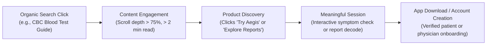

# Hippocrates Healthcare AI — Measurement & Search Analytics Governance
**Document Status:** Complete & Verified  
**Date:** October 2026  
**Target Domain:** https://www.hippocrates.in  

---

## 1. Measurement Architecture & Privacy Guardrails

Healthcare platforms handle sensitive inquiries regarding personal symptoms and laboratory results. Analytics tracking in healthcare must comply with strict privacy boundaries:

> [!CAUTION]
> **Zero Health Information (PHI) in Analytics:**
> Under no circumstances may patient symptoms, blood test values, medical history, or clinical transcripts be passed into URL query parameters, page titles, analytics event labels, or custom dimensions.

### Core Tracking Principles:
1. **Aggregated Interaction Metrics Only:** Track interface actions (e.g., `cta_click: get_started`, `guide_viewed: cbc_test`, `tab_switch: doctor_oracle`).
2. **No Third-Party Advertising Pixels:** No Meta Pixel, TikTok Pixel, or retargeting beacons that scrape DOM text or monitor sensitive health pages.
3. **Privacy-Preserving Search Console Telemetry:** Leverage Google Search Console and Bing Webmaster Tools as the primary sources of truthful organic discovery metrics.

---

## 2. Organic Search Telemetry Matrix

### 2.1 Branded Search Tracking (Entity Health & Disambiguation)

| KPI / Metric | Query Filter / Dimension | Benchmark / Goal | Analysis & Action Trigger |
| :--- | :--- | :--- | :--- |
| **Exact Brand Impressions** | Query: `Hippocrates` | Track baseline volume | Monitor whether Google displays `hippocrates.in` as a site link |
| **Brand Variant Clicks** | Query: `Hippocrates AI`, `Hippocrates healthcare` | Month-over-month growth > 20% | Evaluate CTR from meta title/description adjustments |
| **Official Site Navigational** | Query: `Hippocrates official website`, `Hippocrates app` | Top 3 Average Position (<3.0) | Confirm homepage (`/`) is the primary landing URL |
| **Confusing Entity Queries** | Query: `Hippocratic AI`, `Hippocratic AI alternative` | Monitor impression trends | Identify if users seeking doctor copilots or lab analysis find Hippocrates |
| **Android APK Queries** | Query: `Hippocrates APK`, `Hippocrates Android download` | Top 1 Average Position | Ensure `/get-started` retains snippet and direct download intent |

---

### 2.2 Non-Branded Search Tracking (Topical Authority Clusters)

#### Cluster A: Medical Report & Laboratory Interpretation
- **Target Pages:** `/medical-reports`, `/knowledge/understanding-cbc-blood-test`, `/knowledge/understanding-thyroid-panels`, `/knowledge/understanding-liver-function-tests`, `/knowledge/understanding-kidney-function-tests`
- **Monitored Queries:** `how to understand CBC reports`, `AI medical report explanation`, `TSH blood test meaning`, `creatinine normal range`, `liver function test report explained`.
- **Key Indicators:**
  - **High Impressions / Low Clicks:** Indicates snippet title or description does not sufficiently match searcher intent; trigger metadata rewrite.
  - **Average Position 8–20 (Striking Distance):** High-priority candidates for content enrichment, adding structured summary tables, or updating medical references.

#### Cluster B: Doctor Copilots & Clinical Decision Support
- **Target Pages:** `/oracle`, `/for-doctors`, `/platform`, `/knowledge/ai-clinical-decision-support-explained`
- **Monitored Queries:** `clinical AI copilot`, `AI tools for doctors`, `differential diagnosis software`, `clinical decision support system`.
- **Key Indicators:**
  - Evaluates professional audience reach. Monitor physician registration progression following clicks from these queries.

#### Cluster C: Patient Health Literacy & Doctor Preparation
- **Target Pages:** `/aegis`, `/for-patients`, `/safety`, `/knowledge/how-to-prepare-for-doctor-visit`
- **Monitored Queries:** `how to prepare for doctor visit`, `questions to ask doctor`, `responsible AI in healthcare`.
- **Key Indicators:**
  - Evaluates patient engagement and trust signals.

---

## 3. Crawl & Indexing Health Auditing Protocol

A weekly Google Search Console crawl audit must track:
1. **Pages with Crawl Errors:** Verify 0 instances of 5xx server errors or broken redirects.
2. **Crawled — Currently Not Indexed:**
   - Investigate whether Googlebot deemed any content low-value or duplicative.
   - For any affected `/knowledge/` page: enhance depth, strengthen original citations, or improve internal linking from `/` and `/medical-reports`.
3. **Discovered — Currently Not Indexed:**
   - Usually signals internal linking weakness or crawl budget constraints. Ensure all articles are linked in `/sitemap.xml` and referenced on high-authority parent pages.
4. **Duplicate Without User-Selected Canonical:**
   - Verify that all variants (`http://`, `https://hippocrates-beta.vercel.app`, URLs with trailing slashes) correctly resolve with canonical `https://www.hippocrates.in/...`.

---

## 4. Business Conversion & User Engagement Milestones

Search traffic is valuable only when it fulfills legitimate user needs. We measure organic traffic quality against four core conversion milestones:

### Conversion Events (Privacy-Safe):
1. `auth_signup_patient`: Patient created an account to structure health notes.
2. `auth_signup_doctor`: Doctor registered and submitted Medical Council Registration Number for Oracle access.
3. `apk_download_initiated`: Visitor downloaded `HIPPOCRATES.apk` from `/get-started`.
4. `knowledge_citation_click`: Visitor verified an authoritative clinical source (WHO, ICMR, NIH).
